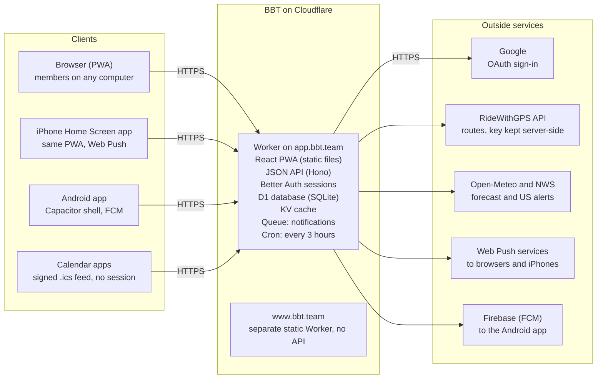
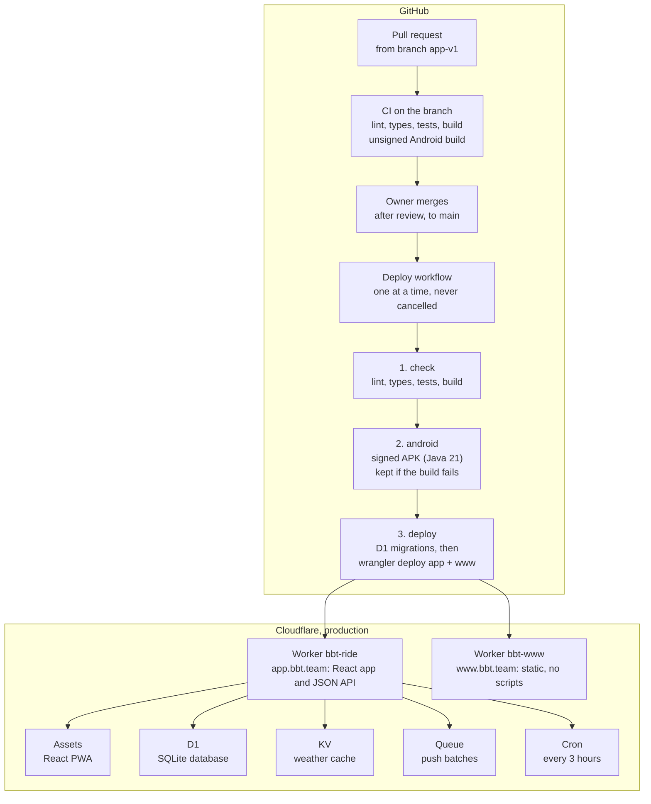
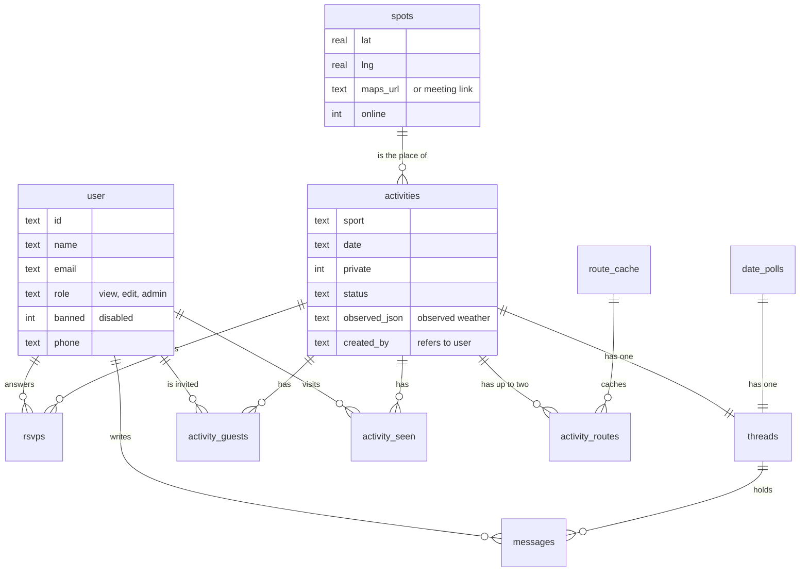
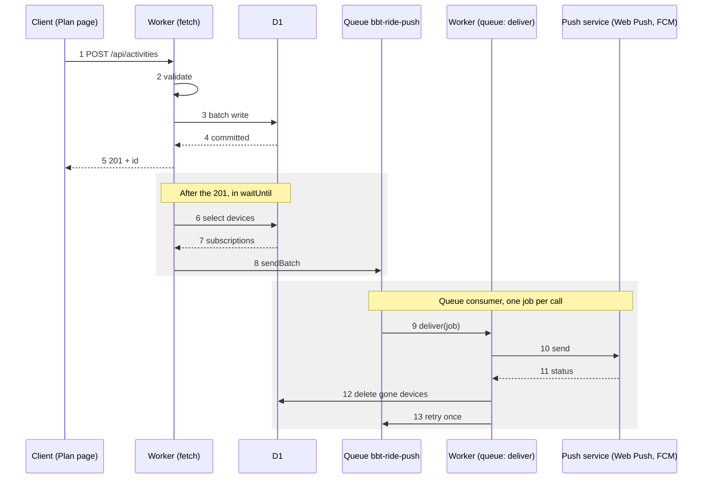

# BBT app architecture

Last updated 2026-10-17. Audience: CTO, developers, DevOps, QA and InfoSec reviewing the design, its decisions and the next steps. The diagrams are Mermaid and render on GitHub.

## Summary

BBT is a single Cloudflare Worker serving a React PWA and a JSON API over one D1 (SQLite) database, plus a Capacitor Android shell; it runs on Cloudflare's free tier with no servers to manage. It plans team activities (rides, runs, swims, pickleball, ski, triathlon, other) for a small invite-only team: weather at the start, RSVPs, messages, notifications, private activities, announcements and online meet-ups.

- **Production:** app.bbt.team (app + API), www.bbt.team (static home page). Deployed on every merge to `main`.
- **Repository:** `mrvadims/bbt-ride` (TypeScript end to end: Worker, React client and shared code).
- **Scale it is built for:** one team, tens to low hundreds of members, a few activities a day.
- **Sources of truth in the repo:** `DESIGN.md` (behaviour and data model), `DECISIONS.md` (decision log), `SETUP.md` (accounts, secrets, DNS), `README.md` (running and testing). This document summarises them as of the date above and does not replace them.

## System context

All clients talk only to the BBT Worker on app.bbt.team over HTTPS; the Worker holds every credential and makes every call to outside services.

The one exception is map tiles: the browser loads route-map tiles directly from OpenStreetMap (light theme) and Carto (dark theme), allowed by name in the Content Security Policy. Notifications leave the Worker through Web Push services (browsers, iPhone Home Screen app) or Firebase Cloud Messaging (Android app).

## Components and deployment

Production is two Cloudflare Workers: `bbt-ride` serves the React app and the API with four bindings; `bbt-www` serves the static home page. GitHub Actions deploys both on every merge to `main`.

| Component | Configuration | Role |
| --- | --- | --- |
| Worker `bbt-ride` | `worker/index.ts`, `compatibility_date` 2026-10-01, `nodejs_compat`, observability on | All `/api/*` requests; everything else is served from static assets |
| Static assets | `not_found_handling: single-page-application`, `run_worker_first: ["/api/*"]` | The built React PWA, service worker, privacy and download pages, with `_headers` (CSP, HSTS) |
| D1 `bbt-ride` | binding `DB`, migrations `0001`–`0020` | All application and auth data |
| KV `CACHE` | binding `CACHE` | Forecasts (30 min), NWS alerts (10 min), the FCM OAuth token (under 1 hour) |
| Queue `bbt-ride-push` | producer `PUSH`; consumer batch size 1, 1 retry | Notification delivery off the request path, 5 devices per message |
| Cron | `15 */3 * * *` | Saves observed weather on recent outdoor activities |
| Worker `bbt-www` | `www/wrangler.jsonc`, assets only, no code | Public home page for bbt.team and www.bbt.team |

Domains are attached to the Workers by hand once (SETUP.md); `workers.dev` and preview URLs are disabled.

## Code structure

One repository and one language: the Worker, the browser app and the Android shell share TypeScript types and pure functions from `shared/`, so the API contract and the weather and ride rules can't drift between client and server.

| Path | What it holds |
| --- | --- |
| `shared/` | Pure, side-effect-free code used by both sides: API shapes and Zod request schemas (`api.ts`), sports rules (`sports.ts`), ride ETA math and places (`ride.ts`), weather evaluation and warnings (`weather.ts`), kit chart, New York time, `.ics` builder, mentions and name cleaning (`people.ts`), date poll rules (`polls.ts`), sport icon list. |
| `worker/` | The Cloudflare Worker: Hono app (`index.ts`), session/role/origin middleware (`app.ts`), Better Auth setup (`auth.ts`, PBKDF2 in `password.ts`), Web Push and FCM delivery (`push.ts`, `fcm.ts`), unread markers (`seen.ts`), message threads (`threads.ts`) and who hears about new messages (`thread-notify.ts`), RideWithGPS client (`rwgps.ts`), the 3-hourly job (`cron.ts`), helpers including the visibility rule (`util.ts`). |
| `worker/routes/` | One Hono router per resource: activities, message edit/delete (any thread), date polls, announcements, calendar feed, drafts, routes, settings, spots (places), users (me, team, admin users, invite/reset links), weather. |
| `src/` | React 19 app: `App.tsx` (routing, sign-in gate), `pages/` (Home, Activity, Plan, date polls, History, Team, Settings, Help, Updates, sign-in, link pages), `components/` (activity body, Who's in, Messages, date poll cards, Plan tabs, mentions, visibility, announcements, charts, map), `lib/` (TanStack Query hooks, API client, router, prefs, units, native bridge). |
| `migrations/` | Plain SQL migrations `0001`–`0020`, applied in order by Wrangler. |
| `android/` | Capacitor 8 Android project: `MainActivity`, a native plugin (`BbtNativePlugin`: share, open external, app update, push), FCM messaging service, RSVP broadcast receiver. |
| `public/`, `www/` | Static assets for the app (service worker, privacy page, download page, `_headers`) and the separate www site. |
| `scripts/` | API smoke test, browser smoke test (Playwright), local seed, icon generation, APK build. |
| `test/` | Vitest unit tests for `shared/` and Worker helpers. |

Dependencies are deliberately few. Runtime: `hono` 4, `better-auth` 1.7, `zod` 4, `@hono/zod-validator`, `@block65/webcrypto-web-push`, `react` 19, `@tanstack/react-query` 5, `leaflet` 1.9, `@capacitor/core` 8.5. Build and test: TypeScript 7, Vite 8 with `@cloudflare/vite-plugin`, Wrangler 4, Vitest 5, Biome 2, Playwright 1.56. Node 22 (`.nvmrc`).

## Data model

All data lives in one D1 database; every reference to a person cascades or becomes NULL when the account is deleted, so deleting a person is one statement.

Better Auth also keeps `session`, `account`, `verification` and `rateLimit` for each user.

| Table | Holds | On delete |
| --- | --- | --- |
| `user`, `session`, `account`, `verification`, `rateLimit` | Better Auth: accounts (role, banned, phone, emergency contact), sessions, sign-in methods, rate-limit counters | Sessions and accounts cascade with the user |
| `activities` | Every activity, past and upcoming (renamed from `rides`) | Children cascade; `created_by` set NULL |
| `activity_routes`, `route_cache` | Up to two routes per activity; cached RideWithGPS data | Routes cascade with the activity |
| `rsvps` | Answers | Cascade with activity |
| `threads`, `messages`, `thread_seen` | One thread per owner (an activity or a date poll); its messages, with one level of replies and system notes; when each person last read a poll's thread | Thread cascades with its owner, messages with the thread; messages keep a NULL author ("Former member") |
| `thread_people` | Per person and thread: follow or mute (Notify me), and when they were last alerted (one card per thread) | Cascade with either side |
| `activity_guests` | Guest list of a private activity (creator included) | Cascade with either side |
| `activity_seen`, `seen_baseline` | Per-person last visit; when markers started for the person | Cascade with either side |
| `date_polls`, `date_poll_guests`, `date_poll_options`, `date_poll_answers`, `date_poll_notes` | Date polls: title, sport, private, closing date, the activity planned from it; a private poll's people; its options (a day or a 2–4-day block); In / Maybe / Out answers with notes; each person's note on the whole poll | Options, answers, notes, guests and the thread cascade with the poll; answers, notes and guest rows with the person; `created_by` set NULL |
| `spots` | Places: pin (lat, lng, Maps link) or online (`online = 1`, meeting link in `maps_url`) | Archived, never deleted |
| `drafts` | One autosaved Plan form per editor | Cascade with user |
| `push_subscriptions` | One row per device: Web Push endpoint or FCM token (`kind`) | Cascade with user |
| `notify_off`, `calendar_links` | Sports a person muted for new posts; calendar link version | Cascade with user |
| `announcements`, `announcement_seen` | Announcements; who tapped Got it | Cascade |
| `links` | Invite and reset links (SHA-256 of the token, role, expiry, used) | Email removed when the account is deleted |
| `settings`, `kit_bands` | Team settings (JSON values) and the kit chart | Not personal |
| `audit_log` | Who did what, when, with a JSON diff | Actor set NULL |

Migrations `0001`–`0020` are plain SQL and only add (`0019` also drops the `messages_v1` copy `0018` kept): new tables, new columns, data fixes. The renames (`rides` to `activities`, `0007`; `messages` to `messages_v1` when threads replaced it, `0018`) and the one column-type change (`0011`) were done by renames, copies and column swaps, never a table rebuild, because D1 enforces foreign keys during a rebuild.

## Key flows

### Publishing an activity and notifying the team

Publishing answers at once; notifications go out after the response, through the queue.

1. The Plan page sends `POST /api/activities` with the session cookie.
2. Middleware runs the `sameOrigin` CSRF check and `requireSession`, then the route checks the role (Editor or Admin), validates the body with Zod (`shared/api.ts`) and runs `checkInput` (place exists, online flag matches the place, route rules per sport, guest list for a private activity).
3. One `DB.batch` writes the activity, its routes, its guests and the audit row atomically.
4. D1 commits the batch.
5. The Worker answers `201` with the id; the client invalidates its TanStack Query caches.
6. `c.executionCtx.waitUntil(announce(...))` runs after the response. `notifyActivity` selects push subscriptions of members who aren't disabled, skipping the author and anyone who muted the sport (`notify_off`). A private activity only ever reaches its invited guests, enforced in the same SQL whatever options the caller passes.
7. D1 returns the matching subscriptions.
8. Devices are split into jobs of 5 (`BATCH`) and queued with one `PUSH.sendBatch`. Five keeps each consumer run inside the free plan's CPU budget, since Web Push encryption costs about 1–2 ms per device.
9. The queue consumer (`deliver`, batch size 1) handles one job per invocation.
10. Web Push devices get a VAPID-signed, encrypted payload (`@block65/webcrypto-web-push`, TTL 24 h, urgency high). Android devices go through FCM HTTP v1 with an OAuth token signed from the service-account secret and cached in KV for under an hour.
11. The push service answers with a status.
12. A 404/410 from Web Push, or a gone FCM token, deletes that subscription.
13. Other failures are logged and re-queued once, only for the failed devices, 60 seconds later. A second failure is logged and dropped.

The same path serves updates, cancellations, restores, deletes (`gone`), mentions (`to`) and announcements (`notifyTeam`, every opted-in device, no activity filter). Thread messages and @here go through `notifyPeople` from `thread-notify.ts`, which picks the people and passes a `tag` (one card per thread) and `quiet` (later messages replace it without sound) that the service worker and Android 1.3 honour.

### Sign-in and sessions

1. Google OAuth or email and password, handled by Better Auth under `/api/auth/*`. Passwords are hashed with PBKDF2-SHA256 at 100,000 iterations (Workers Web Crypto).
2. Invite-only: the `user.create.before` hook refuses any account whose email has no open invite, so an unknown Google account cannot create a user.
3. Password sign-in (email or username) is limited to 5 attempts per 15 minutes per IP, keyed on `cf-connecting-ip`; the counters live in D1 and the cron prunes them daily.
4. Sessions are rows in D1, valid 30 days and renewed at most once a day, with Better Auth's default HttpOnly, Secure, SameSite cookie. There is no cookie cache, so a role change applies on the next request. Disabling a user (the admin plugin's ban) revokes their sessions and blocks sign-in.
5. Every `/api/*` route except auth, health and the calendar feed goes through `requireSession` (401 without a session); state-changing requests must pass `sameOrigin`. The Origin header must equal the app's origin. Role checks (`requireRole`) and the private-activity rule (`visible()`) run in the Worker, never only in the UI.

### Calendar feed

1. Calendar apps fetch `GET /api/cal/<user>.<version>.<signature>.ics` without a session.
2. The Worker checks the HMAC signature and that the version matches the user's current feed version (resetting the link bumps the version, revoking old links).
3. It loads activities with that user as the viewer, so private activities appear only for guests: the ones they are In for, from 30 days back (`PAST_DAYS`) plus upcoming, at most 100.
4. Events are built from stored data and the route cache only; no external call happens per feed request. Online activities use the meeting link as the location and have no geo.

### Weather and recorded weather

1. `GET /api/weather` returns forecasts and alerts for every active outdoor place; online places are skipped.
2. Forecasts come from Open-Meteo and alerts from NWS, each held in KV as one entry per kind with a value per place: 30 minutes for forecasts, 10 minutes for alerts. A failed KV write only means the next request refreshes again.
3. The client computes warnings (rain, storms, wind, wet roads, heat, cold, alerts) and ride clothing from the forecast and the team's thresholds.
4. The cron (`15 */3 * * *`) saves the observed weather (`observed_json`) for outdoor activities up to two days old, so past activities show what the weather actually was.

## Security model

Every `/api/*` route except health, the invite/reset link endpoints and the signed calendar feed requires a session, and every authorization rule is enforced in the Worker; the UI only hides what the server already refuses.

**Authentication**

- Better Auth 1.7 with database sessions in D1: `HttpOnly; Secure; SameSite=Lax` cookie, 30-day expiry renewed daily, no cookie cache (a role change or disable applies on the next request).
- Invite-only: sign-up is disabled; an account is created only for an email with a valid invite (or `BOOTSTRAP_ADMIN_EMAIL` while no Admin exists), enforced in a `user.create.before` hook.
- Two sign-in methods: Google OAuth (tokens discarded after sign-in, no profile photo kept) and email/username + password.
- Passwords: PBKDF2-SHA256, 100,000 iterations, random salt (`worker/password.ts`), 10–128 characters. scrypt was rejected because it exceeds the Workers free-plan CPU limit.
- Invite links (7 days) and reset links (24 hours) are single-use; only the SHA-256 of the token is stored. A reset ends all sessions and removes the person's push devices.
- Rate limiting: 5 password sign-ins per 15 minutes per client IP (`cf-connecting-ip`), counters in D1.
- Better Auth admin endpoints and `is-username-available` are blocked at the router.

**Authorization**

- Three roles: View (shown as Member), Edit, Admin, checked by `requireRole` middleware.
- Private date polls: the same pattern, `pollVisible()` in `worker/util.ts`, on every poll route and in the message edit/delete routes; a poll's notifications reach only its people.
- Private activities: one SQL rule, `visible()` in `worker/util.ts`, is applied in every query that reads activities for a person. Uninvited people (Admins included) get the same 404 as for a missing activity; each write repeats the check inside its D1 batch (`stillVisible`) to close the read-then-write race.
- Notifications for a private activity or poll reach only its people, enforced in SQL wherever recipients are chosen: the `notifyActivity` / `notifyPoll` queueing queries, or `notifyThread`'s recipient select with `visible()` / `pollVisible()`; `notifyPeople` does no check of its own, so every caller must choose recipients that way. An owner that can't be found notifies no one (fail closed).
- Only Admins see other members' roles and emails, in Settings → Users; the Team directory has no roles. Everyone sees names, phones and emergency contacts (a team decision).

**Request hygiene**

- CSRF: data-changing requests must carry the app's own `Origin`, on top of SameSite cookies.
- Input: every body is validated with Zod; bodies over 64 KB are refused; messages are capped at 2,000 characters and 10 mentions; names are cleaned of control and direction characters.
- SQL: D1 prepared statements with bound parameters throughout; the few interpolated fragments are constants.
- API replies are `Cache-Control: no-store`.

**Transport and headers**

- HTTPS only: Cloudflare redirects HTTP, the Worker refuses non-localhost HTTP, HSTS one year with `includeSubDomains` (no preload). The Android app allows no cleartext.
- Static app CSP: `default-src 'self'`, scripts from self only, images from self, data: and the two map tile hosts, `frame-ancestors 'none'`, `object-src 'none'`. The www site allows no scripts at all.
- `Referrer-Policy: no-referrer`, `nosniff`, a restrictive `Permissions-Policy`.

**Secrets**

- Worker secrets (write-only in Cloudflare): `SESSION_SECRET`, `GOOGLE_CLIENT_SECRET`, `RWGPS_API_KEY`, `RWGPS_AUTH_TOKEN`, `VAPID_PRIVATE_KEY`, `FCM_SERVICE_ACCOUNT` (a service account limited to sending notifications).
- GitHub repository secrets: Cloudflare API token and account ID, Android keystore and `google-services.json`. GitHub Actions are pinned to commit SHAs with `contents: read`.
- Nothing secret is in the repo or the built assets; third-party calls that need a credential go through the Worker.

**Privacy and data handling**

- Stored personal data: name, email, optional username, mobile and emergency contact, RSVPs, messages, push endpoints, visits, thread follow and mute choices with last-alerted times, announcement acknowledgements. `/privacy` describes it.
- Deleting an account cascades to sessions, devices, calendar link, RSVPs, visits, guest rows, `thread_people` and acknowledgements; messages remain as "Former member"; the email is removed from old links and the audit trail.
- The audit log records publish, update, cancel, restore, delete, user and announcement changes, with actor and timestamp.

## Operations

There is one production environment and local development; a merge to `main` is the release, and it takes about two and a half minutes from merge to live.

**Environments**

- Production: Worker `bbt-ride` on app.bbt.team, Worker `bbt-www` on www.bbt.team and bbt.team. `workers_dev` and preview URLs are off, so production has no other public hostname.
- Local: `npm run dev` runs the Worker, D1, KV and the Queue in-process through `@cloudflare/vite-plugin`; `npm run db:migrate:local` and `npm run dev:seed` set up data. Local secrets in `.dev.vars`.
- No staging environment (see Future technical enhancements).

**Release pipeline** (`.github/workflows/deploy.yml`, concurrency group `deploy`, never cancelled midway)

1. `check`: `npm ci`, Biome lint, `tsc -b`, Vitest, Vite build (the same job runs on every branch push via `ci.yml`, plus an unsigned Android build).
2. `android`: signed APK built with Java 21 and the keystore from secrets; uploaded as an artifact (7-day retention). If the Android build is skipped or fails, the published APK is carried over so the download never disappears.
3. `deploy`: Vite build, `wrangler d1 migrations apply DB --remote`, `wrangler deploy` (app), `wrangler deploy --config www/wrangler.jsonc` (www).

**Change process:** work on branch `app-v1`, open a pull request (CI runs), the owner reviews and merges, the merge deploys. The branch is then reset to `main`.

**Database migrations:** plain SQL, forward-only, applied before the new code is deployed. Migrations are therefore written to be compatible with the code still running (add columns and tables; avoid renames and table rebuilds, which D1 can't do safely with foreign keys). Data migrations ship as SQL in the same files (e.g. `0017`).

**Configuration:** non-secret variables live in `wrangler.jsonc` (`BETTER_AUTH_URL`, `GOOGLE_CLIENT_ID`, `BOOTSTRAP_ADMIN_EMAIL`, `VAPID_SUBJECT`, `VAPID_PUBLIC_KEY`); secrets via `wrangler secret put` (SETUP.md). Team settings (sports, thresholds, kit chart) are in D1 and edited by Admins.

**Scheduled and background work**

- Cron `15 */3 * * *`: saves observed weather on outdoor activities that ended in the last two days.
- Queue `bbt-ride-push`: one message per batch of up to 5 devices, consumed one message per invocation with one retry, so each run stays inside the free plan's CPU budget.

**Limits that shaped the code:** the Workers free plan allows about 10 ms of CPU per request. This drove PBKDF2 at 100,000 iterations instead of scrypt, Web Push batches of 5, the hand-written `.ics` line folding (a 100-event feed is tested to build in under 25 ms locally), and caching forecasts in KV.

**Observability:** Workers observability (logs) is enabled; errors go to `console.error` with a generic 500 to the client. There is no alerting, uptime check or error tracker yet.

**Backups and recovery:** D1 keeps point-in-time restore for 7 days (stated on the privacy page). Code is in GitHub; a bad deploy is fixed forward, or rolled back with `wrangler rollback` (the database is not rolled back with it). There is no exported off-platform backup yet.

**DNS and edge:** Cloudflare DNS and proxy; Always Use HTTPS, minimum TLS 1.2, TLS 1.3 and Automatic HTTPS Rewrites are on (SETUP.md section 9).

## Testing and quality

CI gates every merge on lint, types, unit tests and a build; the two end-to-end suites run locally against a real Worker and D1, before each pull request, and are not yet in CI.

| Layer | Tool | Where it runs | Scope today |
| --- | --- | --- | --- |
| Lint and format | Biome 2 | CI (every push), locally | Whole repo; CI fails on any error |
| Types | TypeScript 7 (`tsc -b`) | CI, locally | Worker, client, shared, scripts |
| Unit | Vitest 5 | CI, locally | 77 tests: message notification cards and @here, date poll rules (options, closing date, ranking, next weekend), weather and road wetness, bike feel, ETA math (worked examples from DESIGN.md), kit chart, warnings, New York time, `.ics` (including a CPU budget), activity input rules, online places, mentions, names, phones |
| API end to end | `scripts/smoke.ts` (fetch) | Locally against `npm run dev` | 221 checks: invites, sign-in, rate limit, roles, activities, RSVP, messages, Replace, calendar feed, private-activity access matrix (every route x role x invited or not), announcements, online places, date polls (rules, answers, Nudge, close, edit conflicts, messages, private access matrix, Plan this once, private poll into a private activity), message notifications (followers, Notify me, sport mutes, @here; the notify routes in both access matrices) |
| Browser end to end | `scripts/ui-smoke.ts` (Playwright, Chromium) | Locally against `npm run dev` | 90 checks: sign-in and invite pages, Plan, activity page, mentions, @here, Notify me, markers, Team, contacts, delete, private activities, announcements, online meet-ups, date polls, Help, What's new, phone-width layout, a collapsed ride fitting a 390 × 760 phone, dark mode, iPhone install hint; optional screenshots for review |
| Android build | Gradle | CI on branches (unsigned), deploy (signed) | Compiles and passes release lint; no device tests |

**Review practice:** larger changes get an independent security review before merge (for example, private activities: the review found two design issues, fixed before release). Pull request descriptions list the checks run.

**Gaps:** no end-to-end runs in CI; no Safari or real-device (iPhone, Android) automation, so iOS-specific layout bugs reach production (the Plan time-field fix of Oct 15); no load or soak tests; no automated accessibility audit; test data accumulates in the local database between runs.

## Technical decisions and rationale

The recurring driver is a small team, no operations staff and a free-tier budget: every choice favours one platform, few moving parts and server-side enforcement.

| Area | Decision | Why | Trade-off accepted |
| --- | --- | --- | --- |
| Hosting | Cloudflare Workers + static assets, one Worker for app and API | No servers to patch, global edge, free tier, HTTPS and DNS in the same place | Platform lock-in; Workers CPU and runtime limits |
| Database | Cloudflare D1 (SQLite) | Relational data with foreign keys and cascades, transactions via `batch`, free, same platform | Single-region writes; limited `ALTER`; 100 bound parameters per statement (worked around with `json_each`) |
| API framework | Hono with Zod validation | Small, Workers-native, typed routes and middleware | Less batteries-included than a full framework |
| Auth | Better Auth with D1 sessions; Google + password; invite-only | Mature library, database sessions (instant revoke), no third-party identity bill | Library upgrades need care; password hashing had to be swapped for PBKDF2 |
| Password hashing | PBKDF2-SHA256, 100,000 iterations | scrypt/Argon2 exceed the free plan's ~10 ms CPU; 100,000 is the Web Crypto maximum on Workers | Weaker than memory-hard hashing; mitigated by rate limiting and Google sign-in |
| Client | React 19 SPA + TanStack Query, PWA, no SSR | Simple deploy as static files; caching and refetching handled by one library | First load needs JavaScript; no SEO (not needed, members only) |
| Shared code | `shared/` used by Worker and client | One definition of API shapes, rules and math; tested once | Shared code must stay free of browser- and Worker-only APIs |
| Mobile | Android: Capacitor shell + FCM; iPhone: Home Screen web app + Web Push | One codebase; native notification buttons on Android; no App Store fee yet | iPhone notifications have no action buttons; Android APK sideloaded, not on Play Store |
| Notifications | Web Push (VAPID) and FCM, sent through a Cloudflare Queue in batches of 5 | No email service to run; batching keeps each run inside the CPU limit; retries without blocking requests | Delivery is best effort; no per-user delivery report |
| Weather | Open-Meteo forecast and NWS alerts, cached in KV (30 and 10 minutes) | Free, no keys; caching keeps it fast and polite | US-only alerts; forecast quality depends on Open-Meteo |
| Routes | RideWithGPS via the Worker, cached in D1 weekly | Keeps the API key server-side; the team already uses RideWithGPS | Dependency on a third-party API and its account |
| Calendar | Signed per-person `.ics` feed (HMAC of user and version), no session | Calendar apps can't send cookies; Reset revokes the link; nothing secret stored | Anyone holding the URL can read that person's feed until it's reset |
| Private activities | One SQL visibility rule in every read; re-checked inside each write; 404 for outsiders | One place to audit; no existence leak; closes race conditions | Every new query must remember to apply it (code review and tests guard this) |
| Online places | A place is a pin or a meeting link; the server checks the app planned it the same way | Reuses places, times and RSVP; no separate event type | Lat/lng stored as 0 for online places; places in use can't switch type |
| Messages | One `messages` table keyed by thread; one thread per owner, with a nullable owner column per kind (`activity_id`, `poll_id`) | One thread component, API helpers and mention path for every owner; deleting an owner cascades to its thread and messages; a new owner kind is an `ADD COLUMN` plus a trigger that makes the thread, no rebuild | One nullable column per owner kind; mapping tables would allow several threads per owner, not needed now |
| Date polls | Their own tables and routes, with a thread like activities; "Plan this" hands off to Plan and links the activity | No change to activities, the calendar feed or weather; one visibility rule per kind | A poll's options can't be changed after it's sent (title, note and closing date can) |
| Release notes | Inside the app (members only), not the public site | Team content stays behind sign-in | Release notes live in code (`Updates.tsx`) and need a deploy |
| Process | Every change is a pull request; CI then merge deploys; designs reviewed first for UI | Small, reviewable, reversible steps with a human approval | No staging, so review and local tests carry the risk |

## Known limitations and risks

The largest risks are operational, not functional: no staging, no alerting and no off-platform backup, on one owner's accounts.

| Risk | Impact | Likelihood | Current mitigation |
| --- | --- | --- | --- |
| No staging environment; migrations run on production at deploy | A bad migration or deploy reaches members directly | Medium | Forward-compatible migrations, local end-to-end suites, PR review, D1 7-day point-in-time restore |
| No alerting or uptime monitoring | Outages or error spikes go unnoticed until reported | Medium | Workers logs; small user base reports quickly |
| No off-platform backup | Loss beyond D1's 7-day window, or of the Cloudflare account, loses data | Low | D1 point-in-time restore |
| Bus factor: one owner holds Cloudflare, GitHub, Google OAuth, Firebase and RideWithGPS accounts and the Android keystore | Loss of access blocks releases or Android updates | Low | Secrets documented in SETUP.md (names, not values) |
| PBKDF2 at 100,000 iterations | Offline cracking of stolen hashes is cheaper than with memory-hard hashing | Low | Database never leaves Cloudflare; rate limit; Google sign-in available |
| Calendar feed URL is a bearer token | A leaked URL exposes that person's In-for list | Low | Per-person link; Reset or disabling revokes it |
| Third-party dependencies (Open-Meteo, NWS, RideWithGPS, Google, FCM, OSM/Carto tiles) | Features degrade when a provider is down or changes its API | Medium | Caching (KV, D1 route cache); the page still loads without weather or a route |
| End-to-end tests not in CI; no Safari/device automation | Regressions caught late, iOS layout issues reach users | Medium | Manual review on phones; screenshots in PRs |
| Android app sideloaded, iPhone uses Web Push | Install friction; iOS notifications need Home Screen install (iOS 16.4+) | High (by design) | Download page, install hints, in-app update prompt |
| Free-tier ceilings (CPU per request, daily request, Queue operation and storage quotas) | Throttling if usage grows well beyond one team | Low | Code is budgeted for ~10 ms CPU; paid plan is a configuration change |

## Future technical enhancements

The first priority closes the operational gaps above (staging, monitoring, backups, end-to-end tests in CI) before more features land; each item is sized for one pull request or a short series.

**Priority 1: reliability and safety of change**

| Enhancement | What it involves | Benefit | Effort |
| --- | --- | --- | --- |
| Staging environment | Second Worker, D1 and KV (`env.staging` in `wrangler.jsonc`), deployed from the PR branch; migrations rehearsed there first | Catches migration and deploy problems before production | Medium |
| End-to-end suites in CI | Run `smoke.ts` and `ui-smoke.ts` in GitHub Actions against a local Worker with a fresh D1 per run | Regressions blocked at the PR, not found after merge | Small–medium |
| Monitoring and alerting | External uptime check on `/api/health`; Workers Logpush or an error tracker (e.g. Sentry for Workers); alerts on 5xx rate and queue failures | Outages noticed in minutes | Small |
| Off-platform backups | Scheduled `wrangler d1 export` to an encrypted bucket (e.g. R2 with a separate account or S3), with a restore drill | Survives account loss and the 7-day window | Small |
| Access continuity | A second Admin on Cloudflare, GitHub, Google Cloud and Firebase; keystore escrow | Removes the single-owner dependency | Small (non-code) |

**Priority 2: security hardening**

| Enhancement | What it involves | Benefit | Effort |
| --- | --- | --- | --- |
| Stronger password hashing | Move to a memory-hard hash on the paid Workers plan, or passkeys (Better Auth plugin), rehashing on next sign-in | Raises cost of offline attacks | Medium |
| Passkeys or Google-only sign-in | Offer passkeys; consider retiring passwords | Phishing-resistant, no password storage | Medium |
| Security automation | Dependabot or Renovate, CodeQL, `npm audit` in CI, secret scanning on push | Known vulnerabilities flagged automatically | Small |
| Content Security Policy reporting | `report-to` endpoint; drop `'unsafe-inline'` styles where possible | Visibility of injection attempts | Small |
| Audit log viewer and retention | Admin page for the audit log; retention policy | Accountability and data minimisation | Small–medium |

**Priority 3: platform and product capability**

| Enhancement | What it involves | Benefit | Effort |
| --- | --- | --- | --- |
| iPhone app | Capacitor iOS shell, APNs via FCM, App Store listing (Apple fee or nonprofit waiver) | Native notification actions and install on iPhone | Medium–large |
| Android on Google Play | Play Console listing, app signing by Google, staged rollout | Easier install and automatic updates | Small–medium |
| Release notes as data | Move `Updates.tsx` entries to D1 with an Admin editor | Publish notes without a deploy | Small–medium |
| Offline support | Service-worker caching of the upcoming list and activity pages | Works at trailheads with poor signal | Medium |
| Observability of notifications | Record delivery outcomes per device; show Admins failure counts | Diagnose missed notifications | Small–medium |
| Backlog features with technical weight | Route weather along the route by ETA; messenger integration (WhatsApp); weather-model agreement; leave-by alerts (needs a traffic API); capacity with waitlist | Product value | Medium each |
| Scale headroom | If the user base grows well beyond one team: paid Workers plan, D1 read replicas or sharding by team, rate limits on more endpoints | Room to grow without a rewrite | Medium |

## Appendix: API surface

All routes are under `https://app.bbt.team/api`, JSON in and out; "Session" means any signed-in member, and private-activity visibility applies to every activities and messages route.

| Route | Who | Purpose |
| --- | --- | --- |
| `GET /health` | Public | Liveness |
| `GET /cal/<user>.<version>.<sig>.ics` | Signed link | Personal calendar feed (activities the person is In for) |
| `/auth/*` | Public (Better Auth) | Sign-in (Google, email/username + password), sign-out, session |
| `POST /links`, `POST /links/accept` | Valid invite or reset token | Read a link; create the account or set a new password |
| `GET /me`, `PUT /me/contact`, `PUT /me/muted/:sport`, `POST /me/calendar`, `POST /me/calendar/reset` | Session | Own profile, contact details, sport mutes, calendar link |
| `GET /team` | Session | Directory: names, phones, emergency contacts (no roles) |
| `GET /activities`, `GET /activities/past`, `GET /activities/:id`, `POST /activities/:id/seen` | Session | Upcoming list with own answer and unread markers, History, detail, record a visit |
| `POST /activities`, `PUT /activities/:id`, `POST /activities/:id/cancel`, `POST /activities/:id/restore` | Edit or Admin | Publish, update (guest list, Make public, Replace), cancel, restore |
| `DELETE /activities/:id` | Creator (while Edit) or Admin | Delete for good |
| `PUT /activities/:id/rsvp`, `POST /activities/:id/messages`, `PUT /activities/:id/notify` | Session | In / Out / clear; post or reply (notifies followers, @here everyone who can see it); follow or mute the thread |
| `PATCH /messages/:id`, `DELETE /messages/:id` | Author; Edit and Admin can delete any (in threads they can see) | Edit own message; delete (soft), in an activity's or a poll's thread |
| `GET /polls`, `GET /polls/:id`, `POST /polls/:id/seen` | Session (private: its people) | Date polls the viewer is asked on; one poll with answers, Not yet and messages; record a visit |
| `POST /polls` | Edit or Admin | Start a date poll (Public or Private) |
| `PUT /polls/:id`, `POST /polls/:id/close`, `DELETE /polls/:id`, `POST /polls/:id/nudge` | Its creator or Admin (and its people) | Edit title, note, closing date; close; delete; nudge who hasn't answered |
| `PUT /polls/:id/answers`, `POST /polls/:id/messages`, `PUT /polls/:id/notify` | Its people | Answer In / Maybe / Out with notes; post or reply; follow or mute the thread |
| `GET /announcements`, `POST /announcements/:id/seen` | Session | Active and recent announcements; Got it |
| `GET /announcements/all`, `GET /announcements/:id/unseen`, `POST /announcements`, `PUT /announcements/:id`, `POST /announcements/:id/end` | Admin | List with counts, who hasn't seen it, post, edit, end |
| `GET /spots`; `POST /spots`; `PATCH /spots/:id` | Session; Edit; Admin | Places (pin or meeting link): list, add, edit or archive |
| `GET /routes?q=`; `GET /routes/:id` | Edit; Session | Route library search; one route (cached) |
| `GET /weather` | Session | Forecast and NWS alerts for every active map place |
| `GET /settings`; `PUT /settings`, `PUT /settings/kit`, `POST /settings/reset` | Session; Admin | Team settings and kit chart |
| `GET /draft`, `PUT /draft`, `DELETE /draft` | Edit or Admin | The person's autosaved Plan form |
| `POST /push`, `POST /push/app`, `DELETE /push` | Session | Register or remove a Web Push subscription or an Android FCM token |
| `GET /users`, `POST /users/invites`, `DELETE /users/invites/:email`, `POST /users/:id/reset-link`, `PATCH /users/:id`, `DELETE /users/:id` | Admin | Users and invites, reset links, role and disable, delete account |

The browser and the Android app call only these routes; the Worker calls RideWithGPS, Open-Meteo, NWS, FCM and the Web Push services on their behalf.
